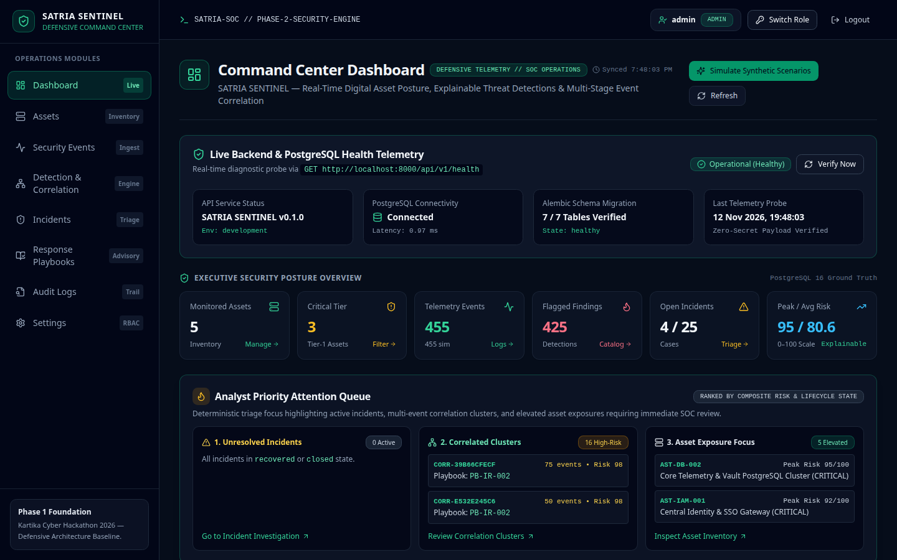
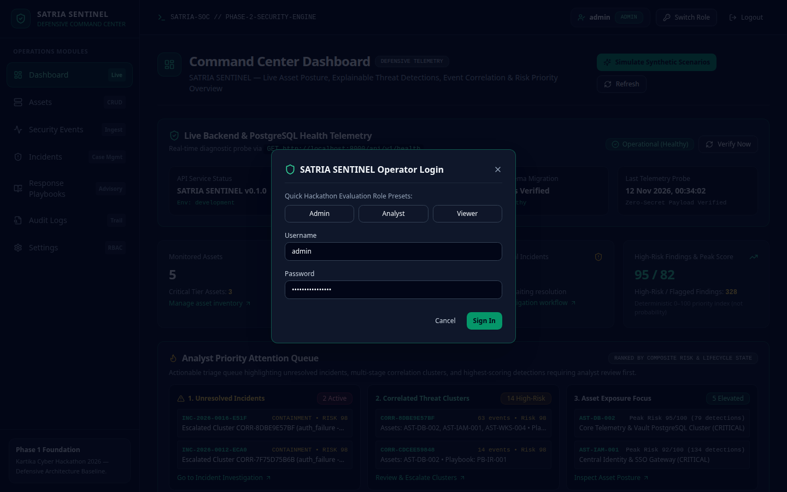
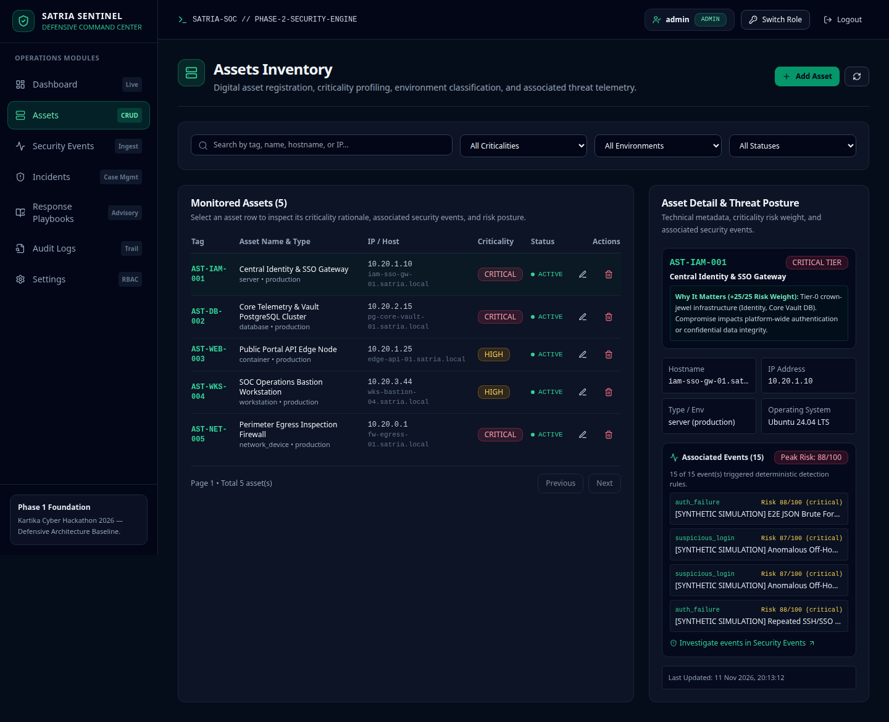
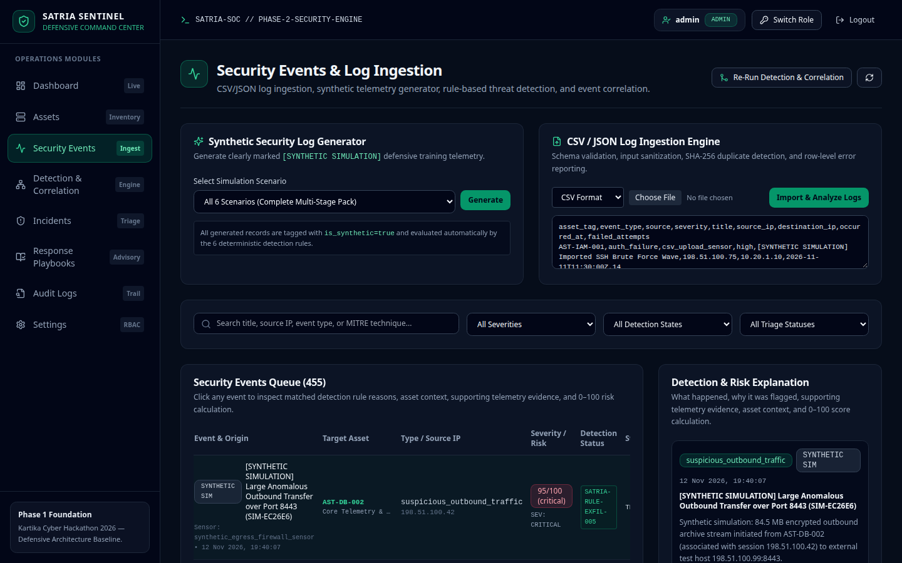
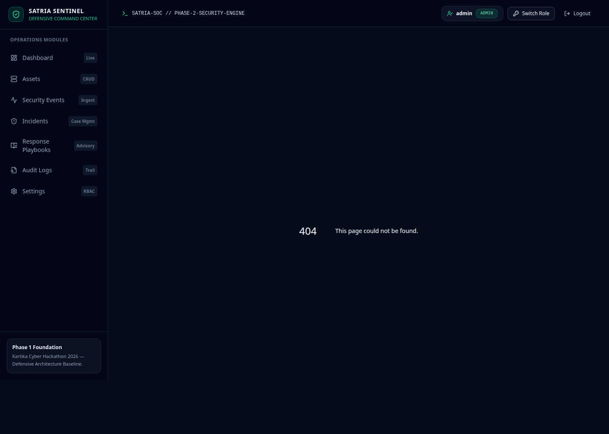
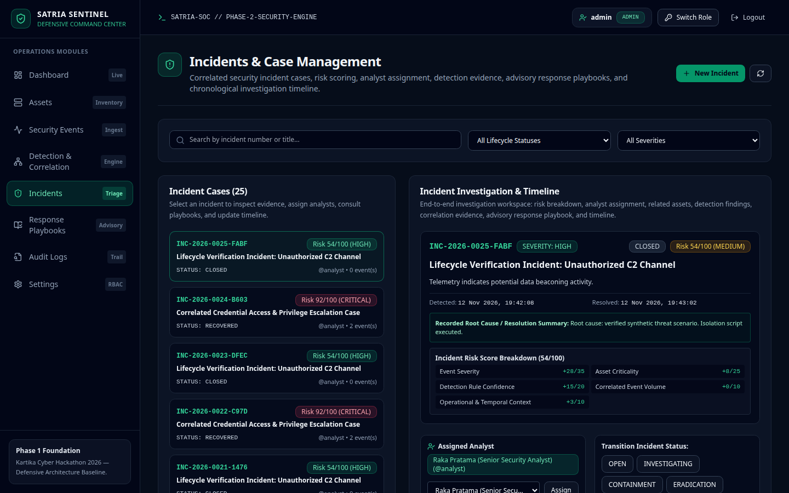
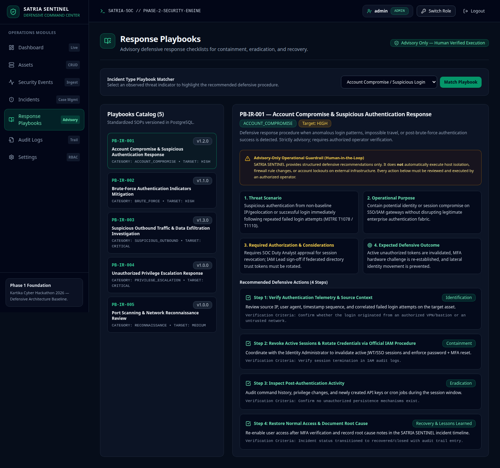
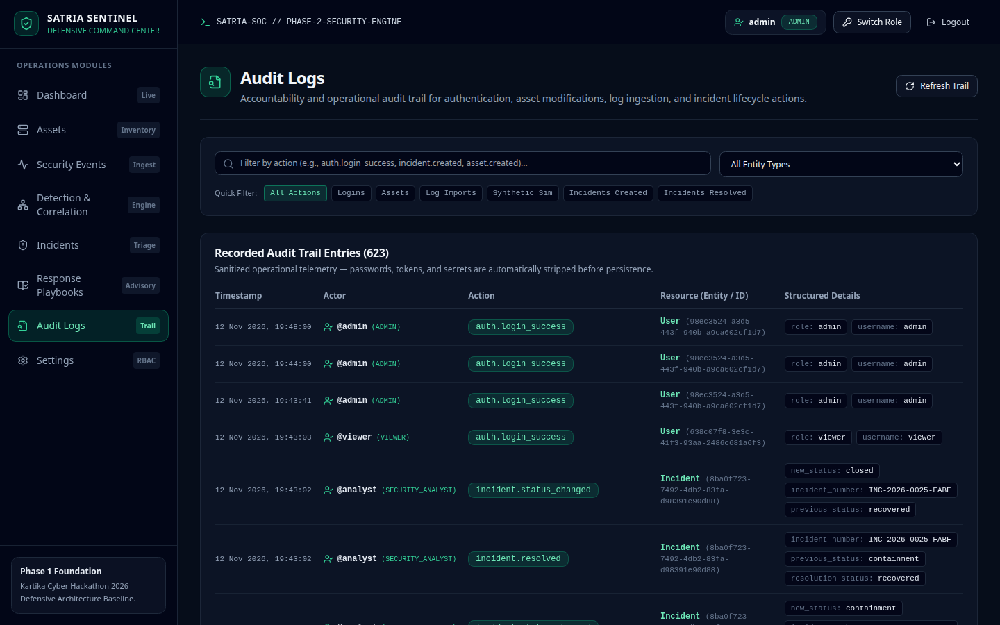
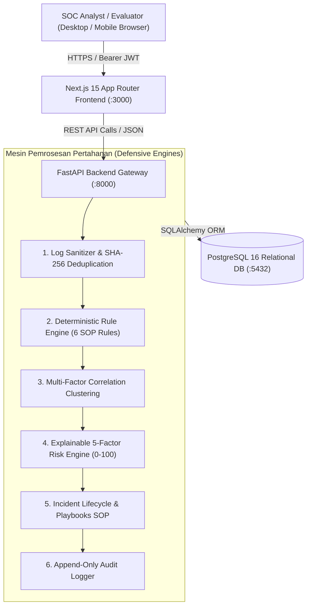

# SATRIA SENTINEL

**Security Asset & Threat Response Intelligence Assistant**  
*Defensive Cybersecurity Prototype for Evaluation & Simulation — Kartika Cyber Hackathon 2026*  
*Kategori: Penangkalan (Cyber Defense) — Status: Prototype Terverifikasi Penuh & Siap Submisi*

[](https://github.com/Maverick-list/satria-sentinel)
[](docs/FINAL_TEST_RESULTS.md)
[](docs/FINAL_TEST_RESULTS.md)
[](docs/FINAL_TEST_RESULTS.md)
[](docker-compose.yml)

---

## 1. Gambaran Umum Proyek & Batasan Ruang Lingkup

**SATRIA SENTINEL** adalah prototipe platform komando pertahanan siber defensif (*Defensive Security Operations Prototype*) yang dikembangkan untuk tujuan evaluasi, riset, dan simulasi penangkalan insiden siber pada **Kartika Cyber Hackathon 2026**.

> [!IMPORTANT]
> **Pernyataan Batasan & Posisioning Sistem**:  
> SATRIA SENTINEL adalah **prototipe perangkat lunak defensif untuk pengujian dan evaluasi kompetisi**. Platform ini **tidak mengklaim** sertifikasi keamanan militer resmi, penyebaran operasional militer nyata (*real-world military deployment*), maupun adopsi SOP militer resmi. Seluruh data telemetri yang digunakan dalam demonstrasi adalah **100% data simulasi sintetis**.

### Pilar Fungsional Prototipe
1. **Pemetaan Aset Berbasis Kritikalitas**: Mengelola inventaris aset digital dengan pembobotan risiko berbasis signifikansi operasional (+6 s/d +25 poin).
2. **Mesin Deteksi Deterministik 6 Aturan**: Mengevaluasi log keamanan secara transparan (*explainable*) terhadap 6 aturan deteksi berbasis taktik MITRE ATT&CK:
   - `SATRIA-RULE-BF-001`: Brute-Force Authentication Indicator (T1110)
   - `SATRIA-RULE-AUTH-002`: Suspicious Login Activity (T1078)
   - `SATRIA-RULE-ACC-003`: Unusual Access Frequency / Bulk Resource Access (T1213)
   - `SATRIA-RULE-PRIV-004`: Suspicious Privilege Escalation or Role Change (T1548)
   - `SATRIA-RULE-EXFIL-005`: Suspicious Outbound Traffic / Exfiltration Indicator (T1041)
   - `SATRIA-RULE-RECON-006`: Port Scanning & Service Reconnaissance Indicator (T1046)
3. **Korelasi Multidimensi & Penilaian Risiko 5-Faktor**: Mengelompokkan kejadian anomali dan menghitung skor risiko komprehensif ($0 - 100$) secara matematis:
   $$\text{Skor} = \min(100, \text{Severity}[0..35] + \text{Asset}[0..25] + \text{Confidence}[0..20] + \text{Volume}[0..10] + \text{Context}[0..10])$$
   - Kategori: Low ($0-29$), Medium ($30-54$), High ($55-79$), Critical ($80-100$).
4. **Ruang Kerja Siklus Hidup Insiden**: Alur kerja investigasi lengkap ($\text{open} \to \text{investigating} \to \text{contained} \to \text{closed}$) dengan kewajiban dokumentasi catatan akar masalah (*root cause*).
5. **Katalog SOP Response Playbooks**: Rekomendasi playbook penanganan pertahanan terstandarisasi NIST SP 800-61 (`PB-IR-001` s.d. `PB-IR-005`) dengan pagar pengaman *Human-in-the-Loop* (advisory only).
6. **Jejak Audit Append-Only Tingkat Aplikasi**: Pencatatan jejak audit append-only di tingkat aplikasi/API untuk setiap mutasi data (*Catatan: modifikasi langsung pada tingkat database PostgreSQL tidak dicegah secara teknis*).

---

## 2. Galeri Tangkapan Layar Prototipe Nyata (*Genuine Screenshots*)

Seluruh tangkapan layar diambil langsung dari aplikasi yang berjalan aktif dan tersedia di [`docs/screenshots/`](docs/screenshots/):

| Command Center Dashboard (`/`) | Operator Login & Role Presets |
| :---: | :---: |
|  |  |
| **Asset Inventory (`/assets`)** | **Security Events & Ingestion (`/security-events`)** |
|  |  |
| **Detection & Correlation (`/detection-correlation`)** | **Incident Investigation Workspace (`/incidents`)** |
|  |  |
| **Response Playbooks (`/playbooks`)** | **Audit Logs (Append-Only) (`/audit-logs`)** |
|  |  |

---

## 3. Tumpukan Teknologi Aktual (*Technology Stack*)

| Lapisan Sistem | Teknologi Terverifikasi | Peran Utama |
| :--- | :--- | :--- |
| **Frontend** | **Next.js 15.5.29 (App Router)**, React 19, TypeScript 5.8, Tailwind CSS, Recharts | Antarmuka command center responsif tema gelap taktis |
| **Backend** | **Python 3.14 / FastAPI 0.115**, Uvicorn ASGI Server, Pydantic 2.10 | API Gateway asinkron berkecepatan tinggi & mesin pemrosesan logika pertahanan |
| **Database** | **PostgreSQL 16 Alpine**, SQLAlchemy 2.0 ORM, Psycopg 3.2, Alembic 1.14 | Penyimpanan relasional transaksional ACID 7 entitas model |
| **Security Core**| **RFC 7914 scrypt** ($N=16384, r=8, p=1$), **RFC 7519 JWT HS256**, RBAC 3-Level | Hashing kata sandi memory-hard, token otentikasi aman, dan kontrol akses berjenjang |
| **Testing** | **Pytest 9.2**, **Playwright 1.50** (Chromium Browser Engine) | Uji unit, integrasi API, dan otomatisasi verifikasi alur kerja pengguna end-to-end |
| **DevOps** | **Docker Engine**, Docker Compose v2, Git & GitHub CLI | Kontainerisasi layanan dan deployment reproducibility |

---

## 4. Diagram Arsitektur & Alur Sistem



Diagram teknis selengkapnya tersedia di direktori [`docs/diagrams/`](docs/diagrams/):
- [Diagram Arsitektur Sistem](docs/diagrams/system-architecture.md)
- [Diagram Aliran Data](docs/diagrams/data-flow.md)
- [Diagram Alur Deteksi](docs/diagrams/detection-flow.md)
- [Diagram Formula Skor Risiko](docs/diagrams/risk-scoring-flow.md)
- [Diagram Siklus Hidup Insiden](docs/diagrams/incident-lifecycle.md)
- [Diagram Arsitektur Penerapan](docs/diagrams/deployment-architecture.md)
- [Diagram Entitas Relasi Database (ERD)](docs/diagrams/database-erd.md)

---

## 5. Panduan Menjalankan Aplikasi Secara Cepat

### A. Menjalankan via Docker Compose (Direkomendasikan)
```bash
# 1. Kloning repositori
git clone https://github.com/Maverick-list/satria-sentinel.git
cd satria-sentinel

# 2. Siapkan file environment
cp .env.example .env

# 3. Jalankan kontainer
docker compose up -d --build
```
Akses platform melalui browser:
- **Frontend Dashboard**: [http://localhost:3000](http://localhost:3000)
- **Backend API Docs (Swagger)**: [http://localhost:8000/docs](http://localhost:8000/docs)
- **Health Check API**: [http://localhost:8000/api/v1/health](http://localhost:8000/api/v1/health)

### B. Prosedur Evaluasi Akses Demo Aman
Untuk menjaga kebersihan repositori dan keamanan kredensial, **tidak ada kata sandi yang dipublikasikan dalam repositori ini**. 
Akses peninjauan disediakan secara aman melalui:
1. **Modal Login Preset Antarmuka**: Klik tombol **"Operator Login"** di pojok kanan atas antarmuka, lalu pilih salah satu tombol peran instan (**Admin**, **Analyst**, atau **Viewer**). Antarmuka akan secara otomatis memanggil endpoint autentikasi menggunakan parameter demo terisolasi.
2. **Kustomisasi Mandiri via `.env`**: Operator dapat mengonfigurasi awalan dan akhiran kata sandi demo secara mandiri melalui variabel `SATRIA_DEMO_ACCESS_PREFIX` dan `SATRIA_DEMO_ACCESS_SUFFIX` pada file `.env` lokal masing-masing.

---

## 6. Verifikasi Kualitas & Hasil Pengujian

Seluruh suite pengujian otomatis telah dieksekusi dengan hasil **100% LULUS**:

```
[Pytest Backend Suite]            10 / 10 PASSED (1.33s)
[Frontend TypeScript Checks]       0 ERRORS (1.8s)
[Next.js Production Build]        10 / 10 STATIC ROUTES COMPILED (1.1s)
[Playwright End-to-End Suite]      4 / 4 PASSED (5.8s)
[Live Browser Workflow Test]      10 / 10 WORKFLOWS PASSED (9.2s)
[Repository Secret Scan]          0 SECRETS FOUND (Exit Code 0)
[Alembic Database Migration]      HEAD CONFIRMED (7 Tables Active)
[Docker Container Health]          POSTGRESQL 16 HEALTHY
```
*Laporan lengkap dan rekaman terminal dapat diperiksa pada [`docs/FINAL_TEST_RESULTS.md`](docs/FINAL_TEST_RESULTS.md).*

---

## 7. Indeks Dokumentasi Proyek (`docs/` & `submission/`)

### Dokumentasi Arsitektur & Teknis
- [`docs/PROJECT_OVERVIEW.md`](docs/PROJECT_OVERVIEW.md) — Problem statement, solusi 4 pilar, dan batasan ruang lingkup prototipe.
- [`docs/TECHNOLOGY_STACK.md`](docs/TECHNOLOGY_STACK.md) — Rincian versi dependensi dan rasional pemilihan teknologi.
- [`docs/SYSTEM_ARCHITECTURE.md`](docs/SYSTEM_ARCHITECTURE.md) — Arsitektur berlapis bersih, struktur folder, dan prinsip desain.
- [`docs/STACK_FLOW.md`](docs/STACK_FLOW.md) — Alur data dari ingesti, deteksi, korelasi, hingga visualisasi dasbor.
- [`docs/DATABASE_DESIGN.md`](docs/DATABASE_DESIGN.md) — Spesifikasi 7 tabel relasional, foreign keys, tipe data, dan indeks.
- [`docs/API_REFERENCE.md`](docs/API_REFERENCE.md) — Referensi lengkap seluruh endpoint REST API `/api/v1` beserta contoh JSON.
- [`docs/DETECTION_ALGORITHMS.md`](docs/DETECTION_ALGORITHMS.md) — Logika teknis 6 aturan deteksi deterministik dan pemetaan MITRE.
- [`docs/RISK_SCORING_METHODOLOGY.md`](docs/RISK_SCORING_METHODOLOGY.md) — Formula matematis penilaian risiko 5 faktor (0-100) dan klasifikasi level.
- [`docs/SECURITY_METHODOLOGY.md`](docs/SECURITY_METHODOLOGY.md) — Dokumentasi scrypt, HS256 JWT, RBAC, dan audit logging append-only.
- [`docs/TESTING_AND_QA.md`](docs/TESTING_AND_QA.md) — Piramida pengujian, skenario Playwright, dan bukti pengujian.
- [`docs/DEPLOYMENT_GUIDE.md`](docs/DEPLOYMENT_GUIDE.md) — Panduan penerapan Docker Compose, bare-metal, dan arsitektur cloud.
- [`docs/USER_GUIDE.md`](docs/USER_GUIDE.md) — Panduan interaksi langkah demi langkah bagi analis dan juri kompetisi.
- [`docs/DEVELOPER_GUIDE.md`](docs/DEVELOPER_GUIDE.md) — Panduan kontribusi kode dan penambahan aturan deteksi baru.
- [`docs/KNOWN_LIMITATIONS.md`](docs/KNOWN_LIMITATIONS.md) — Transparansi batasan prototipe dan pertimbangan rekayasa.
- [`docs/FUTURE_ROADMAP.md`](docs/FUTURE_ROADMAP.md) — Rencana pengembangan strategis pasca-hackathon (Fase 5 - 7).

### Berkas Submisi Kompetisi (`submission/`)
- [`submission/PROJECT_DESCRIPTION.md`](submission/PROJECT_DESCRIPTION.md) — Proposal submisi resmi kategori Penangkalan.
- [`submission/DEMO_SCRIPT.md`](submission/DEMO_SCRIPT.md) — Naskah video demonstrasi 10 menit dengan panduan visual.
- [`submission/PRESENTATION_OUTLINE.md`](submission/PRESENTATION_OUTLINE.md) — Kerangka presentasi 10 slide untuk dewan juri.
- [`submission/SCREENSHOT_CHECKLIST.md`](submission/SCREENSHOT_CHECKLIST.md) — Panduan 5 tangkapan layar utama antarmuka.
- [`submission/THUMBNAIL_SPEC.md`](submission/THUMBNAIL_SPEC.md) — Spesifikasi teknis thumbnail video YouTube (1200x630 px).

---

## 8. Lisensi & Hak Cipta

Dikembangkan oleh **Tim SATRIA SENTINEL** untuk **Kartika Cyber Hackathon 2026**.  
*Lisensi: Open Source untuk kepentingan riset, evaluasi pertahanan siber, dan kompetisi pertahanan.*
