# SATRIA SENTINEL — System Architecture

## 1. High-Level Architecture

SATRIA SENTINEL menerapkan arsitektur *layered modular monorepo* yang memisahkan tanggung jawab antara presentasi (Next.js App Router), layanan aplikasi & domain (FastAPI), dan persistensi relasional (PostgreSQL).

```mermaid
flowchart LR
    subgraph Client["Frontend (Next.js App Router :3000)"]
        UI["Command Center UI\n(7 Pages + AppShell)"]
        Hooks["React Hooks\n(useBackendHealth)"]
        ApiClient["Typed API Client\n(src/services/api-client.ts)"]
        UI --> Hooks --> ApiClient
    end

    subgraph Server["Backend (FastAPI :8000)"]
        MW["Security Headers, CORS\n& Request-ID Middleware"]
        Router["API v1 Router\n(/api/v1/health)"]
        Service["Application Services\n(HealthService)"]
        Repo["Repositories\n(BaseRepository, HealthRepository)"]
        ORM["SQLAlchemy 2.x ORM Models\n& Alembic Migrations"]
        MW --> Router --> Service --> Repo --> ORM
    end

    subgraph Data["Database (:5432)"]
        PG[("PostgreSQL 16\n7 Core Tables")]
    end

    ApiClient -->|"HTTP JSON (/api/v1)"| MW
    ORM -->|"psycopg v3 pool"| PG
```

---

## 2. Backend Layered Architecture (`backend/app/`)

Backend dirancang agar setiap lapisan memiliki tanggung jawab tunggal (*Single Responsibility Principle*):

1. **`app/core/` (Core Configuration & Cross-Cutting Concerns)**
   - `config.py`: Memuat dan memvalidasi environment variable menggunakan `pydantic-settings` (`Settings`).
   - `logging.py`: Mengonfigurasi *structured JSON logging* (`StructuredJsonFormatter`) ke `stdout` dengan atribut `timestamp`, `level`, `logger`, `message`, dan `request_id`.
   - `exceptions.py`: Menangani `AppError`, `HTTPException`, `RequestValidationError`, dan `Exception` tak terduga ke dalam format amplop JSON standar (`error.code`, `error.message`, `error.request_id`, `error.timestamp`) tanpa pernah menampilkan *stack trace* ke pengguna.
2. **`app/db/` (Database Connection & Declarative Base)**
   - `base.py`: Mendefinisikan `Base` (`DeclarativeBase`) dengan konvensi penamaan constraint PostgreSQL (`pk_`, `fk_`, `ix_`, `uq_`), serta mixin `UUIDPrimaryKeyMixin` dan `TimestampMixin`.
   - `session.py`: Mengelola `engine` (`pool_pre_ping=True`) dan dependency `get_db()` per HTTP request.
3. **`app/models/` (Domain ORM Models)**
   - Mengimplementasikan 7 tabel utama: `User`, `Asset`, `SecurityEvent`, `ResponsePlaybook`, `Incident`, `IncidentEvent`, dan `AuditLog`.
4. **`app/schemas/` (Pydantic v2 Schemas)**
   - Memvalidasi parameter input (`HealthCheckQuery`, `PaginationParams`) dengan `extra="forbid"` dan menyerialisasi respons (`HealthCheckResponse`).
5. **`app/repositories/` (Data Access Layer)**
   - `base.py`: `BaseRepository[ModelType]` generik untuk operasi pembacaan ORM.
   - `health_repository.py`: `HealthRepository` yang menjalankan probe `SELECT 1`, menghitung latensi dalam milidetik, dan memeriksa keberadaan 7 tabel fondasi melalui SQLAlchemy inspector.
6. **`app/services/` (Service Layer)**
   - `health_service.py`: Mengorkestrasi pemeriksaan kesehatan sistem dan menangani kegagalan koneksi database secara *graceful* (mengembalikan status `degraded` / HTTP `503` tanpa membocorkan string koneksi).
7. **`app/api/v1/` (Presentation / HTTP Layer)**
   - `routes/health.py`: Menyediakan endpoint `GET /api/v1/health`.

---

## 3. Frontend Layered Architecture (`frontend/src/`)

1. **`src/app/` (Next.js App Router Pages)**
   - Mengimplementasikan 7 rute utama: `/` (Dashboard), `/assets`, `/security-events`, `/incidents`, `/playbooks`, `/audit-logs`, dan `/settings`.
2. **`src/components/` (Reusable UI & Layout)**
   - `ui/`: Komponen primitif bergaya `shadcn/ui` (`Button`, `Card`, `Badge`, `Separator`).
   - `layout/`: `AppShell`, `SidebarNav`, dan `TopHeader` responsif (mendukung desktop sidebar & mobile drawer).
3. **`src/features/` (Feature Modules)**
   - `health/`: `SystemHealthPanel` (komunikasi nyata ke `/api/v1/health`) dan `SchemaReadinessChart` (visualisasi Recharts untuk profil kolom & indeks aktual dari 7 tabel database).
   - `modules/`: `ModuleFoundationView` yang menyajikan spesifikasi tabel, *foreign keys*, indeks, dan roadmap Phase 2 secara transparan.
   - `navigation/`: Definisi terpusat menu navigasi Command Center.
4. **`src/services/` & `src/hooks/`**
   - `api-client.ts`: Wrapper `fetch` bertipe kuat (`apiFetch<T>`) dengan penanganan `ApiClientError`.
   - `health-service.ts` & `use-backend-health.ts`: Mengambil dan menyegarkan status kesehatan backend secara reaktif.
5. **`src/types/` & `src/lib/`**
   - Kontrak TypeScript yang selaras dengan Pydantic schema di backend.
