# SATRIA SENTINEL — System Architecture

## 1. Arsitektur Tingkat Tinggi (*High-Level Architecture*)

```mermaid
flowchart LR
    subgraph Client["Frontend — Next.js 15 App Router (:3000)"]
        UI_Dash["Dashboard & Risk Overview"]
        UI_Assets["Asset Inventory CRUD"]
        UI_Events["Log Ingestion, Synthetic Gen & Detections"]
        UI_Inc["Incident Case Management & Timeline"]
        UI_PB["Advisory Response Playbooks"]
        UI_Audit["Application-Level Audit Trail"]
        UI_Auth["Auth & RBAC Context (JWT)"]
    end

    subgraph API["Backend — FastAPI REST API (:8000 /api/v1)"]
        MW_Auth["JWT Auth & RBAC Dependencies"]
        R_Ingest["Ingestion & Synthetic Generator Service"]
        R_Detect["Deterministic Rule Detection Engine"]
        R_Corr["Multi-Factor Event Correlation Engine"]
        R_Risk["0-100 Composite Risk Scoring Engine"]
        R_Inc["Incident & Playbook Workflow Service"]
        R_Audit["Audit Trail Service"]
    end

    subgraph DB["Persistence — PostgreSQL 16 (:5432)"]
        PG[("PostgreSQL 16\n7 Core Tables\nAlembic Migrations 0001 & 0002")]
    end

    Client <-->|"HTTP JSON + Bearer JWT"| API
    API <-->|"SQLAlchemy 2.0 ORM"| PG
```

---

## 2. Pemisahan Lapisan Backend (`backend/app/`)

- **`api/deps.py`**: *Dependency injection* untuk autentikasi Bearer JWT (`get_current_user`) dan otorisasi berbasis peran (`require_viewer_or_above`, `require_analyst_or_admin`, `require_admin`).
- **`api/v1/routes/`**: 12 modul *endpoint* RESTful (`health`, `auth`, `users`, `assets`, `security_events`, `log_ingestion`, `detections`, `correlations`, `risk_assessments`, `incidents`, `playbooks`, `audit_logs`).
- **`core/`**: Konfigurasi berbasis *environment variables* (`config.py`), kriptografi password `scrypt` & JWT HS256 (`security.py`), penanganan *exception* terpusat tanpa kebocoran *stack trace* (`exceptions.py`), dan *structured JSON logging* (`logging.py`).
- **`models/`**: Model ORM SQLAlchemy 2.0 untuk 7 tabel inti beserta enumerasi domain.
- **`schemas/`**: Skema validasi input/output Pydantic v2 (`operational.py`, `health.py`, `common.py`).
- **`services/`**: Logika bisnis inti dan mesin keamanan:
  - `synthetic_generator.py`: Generator 6 skenario log keamanan simulasi.
  - `ingestion_service.py`: Parser CSV/JSON, sanitasi input, dan deduplikasi SHA-256.
  - `detection_engine.py`: Mesin evaluasi 6 aturan deteksi deterministik.
  - `correlation_engine.py`: Mesin pengelompokan kejadian keamanan multi-faktor.
  - `risk_engine.py`: Mesin perhitungan skor risiko komposit `0–100`.
  - `audit_service.py`: Pencatatan jejak audit operasional.
  - `bootstrap_service.py`: Inisialisasi idempoten akun RBAC, aset awal, dan katalog *playbooks*.

---

## 3. Pemisahan Lapisan Frontend (`frontend/src/`)

- **`app/`**: Halaman Next.js App Router (`/`, `/assets`, `/security-events`, `/incidents`, `/playbooks`, `/audit-logs`, `/settings`).
- **`features/auth/auth-context.tsx`**: Penyedia konteks sesi JWT, pergantian peran operator (*Admin*, *Analyst*, *Viewer*), dan sistem *toast notification*.
- **`services/`**: Klien HTTP generik (`api-client.ts`) dengan dukungan *Bearer token* dan modul layanan terketik (`operational-service.ts`, `health-service.ts`).
- **`types/`**: Definisi tipe TypeScript yang selaras dengan skema Pydantic *backend* (`operational.ts`, `health.ts`).
- **`components/`**: Komponen tata letak (`app-shell.tsx`, `sidebar-nav.tsx`, `top-header.tsx`) dan elemen UI (`card.tsx`, `badge.tsx`, `button.tsx`).
