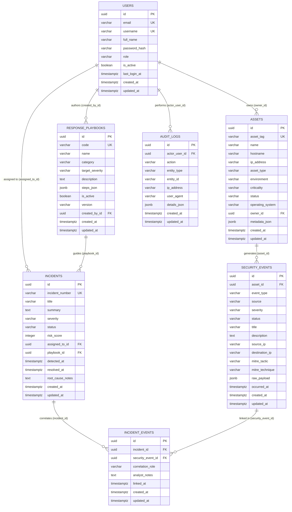

# SATRIA SENTINEL — Database Design (Phase 1)

## 1. Design Principles

1. **UUIDv4 Primary Keys**: Seluruh 7 tabel utama menggunakan kolom `id UUID PRIMARY KEY` untuk mencegah *enumeration* ID berurutan dan memudahkan pembuatan ID terdistribusi.
2. **Timezone-Aware Timestamps**: Seluruh kolom waktu menggunakan `TIMESTAMPTZ` (`DateTime(timezone=True)`) dalam UTC (`created_at`, `updated_at`, `occurred_at`, `detected_at`, `linked_at`).
3. **Safe Referential Integrity**:
   - Relasi ke `users` (`owner_id`, `assigned_to_id`, `created_by_id`, `actor_user_id`) menggunakan `ON DELETE SET NULL` agar penghapusan akun operator tidak pernah menghilangkan histori aset, insiden, playbook, maupun log audit.
   - Tabel asosiasi `incident_events` menggunakan `ON DELETE CASCADE` terhadap `incidents` dan `security_events`, dilengkapi constraint unik `(incident_id, security_event_id)`.
4. **Structured Extensibility via JSONB**: Atribut telemetri mentah (`raw_payload`), metadata aset (`metadata_json`), langkah playbook (`steps_json`), dan detail audit (`details_json`) disimpan menggunakan tipe `JSONB` PostgreSQL.

---

## 2. Entity-Relationship Diagram (ERD)

---

## 3. Table & Index Inventory

| Table Name | ORM Class | Unique Constraints | Key Single & Composite Indexes |
| :--- | :--- | :--- | :--- |
| `users` | `User` | `email`, `username` | `ix_users_email`, `ix_users_username`, `ix_users_role` |
| `assets` | `Asset` | `asset_tag` | `ix_assets_asset_tag`, `ix_assets_hostname`, `ix_assets_ip_address`, `ix_assets_crit_status (criticality, status)` |
| `security_events` | `SecurityEvent` | — | `ix_security_events_severity_occurred (severity, occurred_at)`, `ix_security_events_asset_occurred (asset_id, occurred_at)`, `ix_security_events_mitre_technique` |
| `response_playbooks` | `ResponsePlaybook` | `code` | `ix_response_playbooks_code`, `ix_response_playbooks_category`, `ix_response_playbooks_is_active` |
| `incidents` | `Incident` | `incident_number` | `ix_incidents_incident_number`, `ix_incidents_status_severity (status, severity)`, `ix_incidents_detected_at` |
| `incident_events` | `IncidentEvent` | `(incident_id, security_event_id)` | `ix_incident_events_incident_id`, `ix_incident_events_security_event_id` |
| `audit_logs` | `AuditLog` | — | `ix_audit_logs_entity (entity_type, entity_id)`, `ix_audit_logs_action_created (action, created_at)` |
