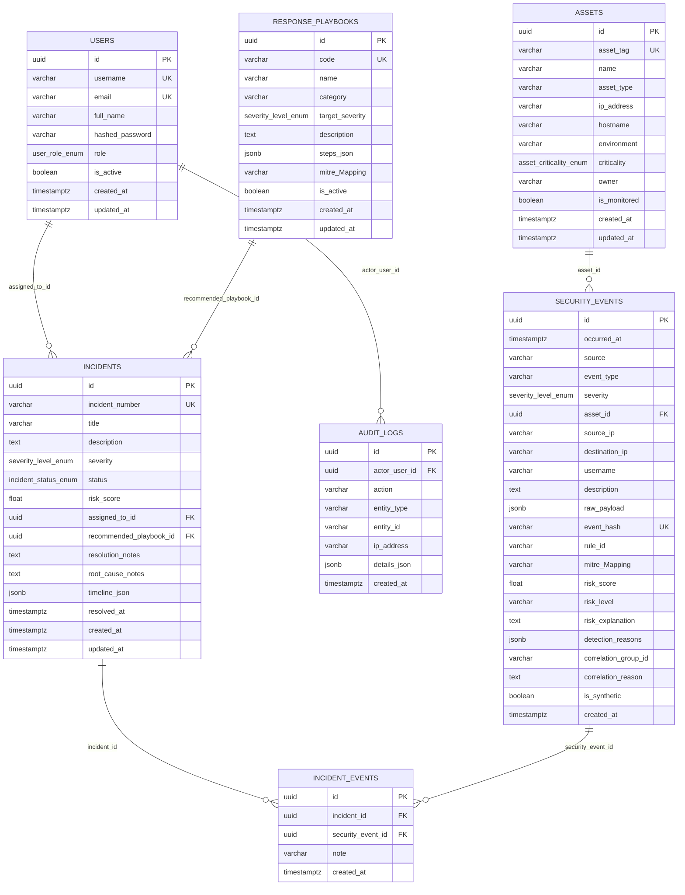

# SATRIA SENTINEL — Database Design & Schema Reference

## 1. Gambaran Umum Database

- **DBMS**: PostgreSQL 16 (`postgres:16-alpine`)
- **ORM & Migration**: SQLAlchemy 2.0.35 + Alembic 1.13.3
- **Revisi Migrasi Aktif (`head`)**:
  1. `20261111_0001` (`backend/alembic/versions/20261111_0001_initial_foundation_schema.py`): Pembuatan 7 tabel fondasi beserta enumerasi dan indeks.
  2. `20261111_0002` (`backend/alembic/versions/20261111_0002_phase2_operational_columns.py`): Penambahan kolom operasional Phase 2 (`users.username`, `security_events.event_hash`, `security_events.risk_level`, `security_events.risk_explanation`, `security_events.detection_reasons`, `security_events.correlation_reason`, `security_events.is_synthetic`, `incidents.timeline_json`, dan `incidents.root_cause_notes`).

---

## 2. Diagram Relasi Entitas (*Entity-Relationship Diagram*)

---

## 3. Indeks & Integritas Data

- **Deduplikasi Kejadian (`ix_security_events_event_hash`)**: Indeks unik pada `security_events.event_hash` (SHA-256) mencegah duplikasi impor log CSV/JSON yang identik.
- **Indeks Korelasi & Pencarian Cepat**: Indeks pada `security_events.occurred_at`, `security_events.event_type`, `security_events.severity`, `security_events.asset_id`, dan `security_events.correlation_group_id` mendukung kueri korelasi lintas waktu dan aset secara efisien.
- **Kaskade Relasi**: Tabel jembatan `incident_events` menggunakan `ON DELETE CASCADE` terhadap `incidents.id` dan `security_events.id`, sedangkan referensi analitik seperti `security_events.asset_id` dan `audit_logs.actor_user_id` menggunakan `ON DELETE SET NULL` agar histori kejadian dan jejak audit tetap terjaga.
