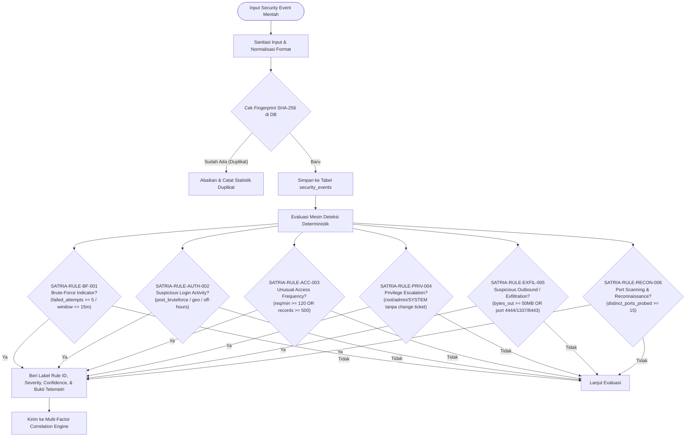

# Diagram Alur Deteksi Ancaman (Detection Flow)

Diagram alur ini merinci evaluasi 6 aturan deteksi deterministik sesuai kode implementasi aktual di [`backend/app/services/detection_engine.py`](file:///home/firza-ilmi/.gemini/antigravity/scratch/satria-sentinel/backend/app/services/detection_engine.py):

