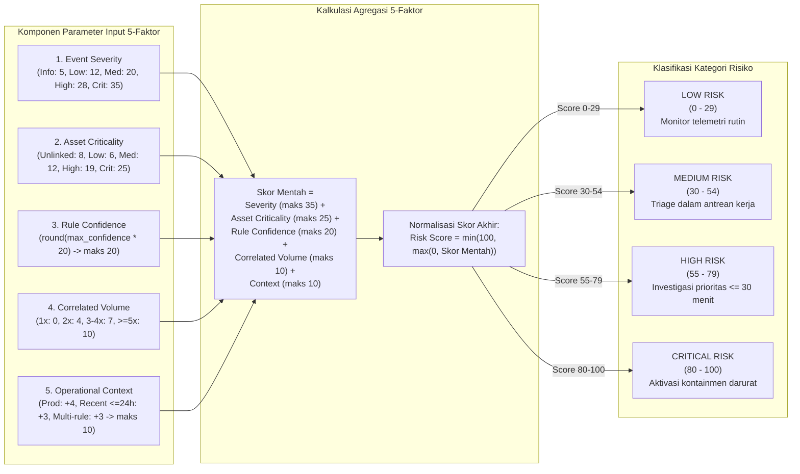

# Diagram Alur Penilaian Risiko (Risk Scoring Flow)

Diagram alur ini mendeskripsikan formula penilaian risiko matematis 5 faktor ($0 \text{ hingga } 100$) sesuai implementasi aktual pada [`backend/app/services/risk_engine.py`](file:///home/firza-ilmi/.gemini/antigravity/scratch/satria-sentinel/backend/app/services/risk_engine.py):

