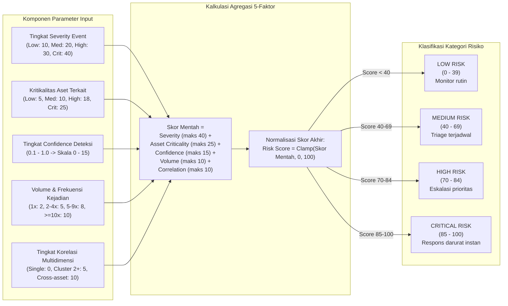

# Diagram Alur Penilaian Risiko (Risk Scoring Flow)

Diagram alur ini mendeskripsikan formula penilaian risiko matematis 5 faktor ($0 \text{ hingga } 100$) yang transparan dan dapat dijelaskan (*explainable*):

