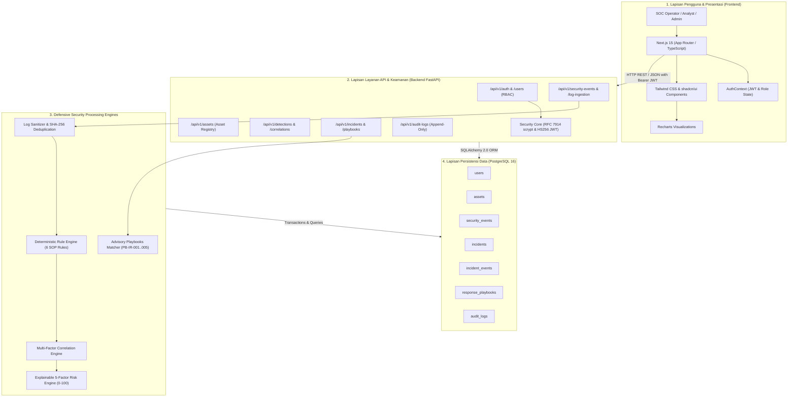

# Diagram Arsitektur Sistem SATRIA SENTINEL

Diagram ini mengilustrasikan arsitektur modular SATRIA SENTINEL yang memisahkan presentasi (Next.js App Router), API gateway & orkestrasi (FastAPI), serta persistensi data relasional (PostgreSQL 16).

